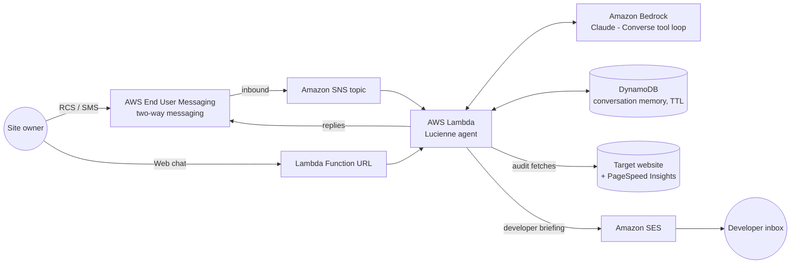

# Lucienne — Conversational Website & SEO Copilot

*From lux/luz: the one who brings light.* Text Lucienne a website address and she
inspects it like a meticulous senior engineer — speed, search visibility, metadata,
indexing — then explains what she found in plain words, over the channel you're
already on. Ask for depth and she emails the full developer briefing.

Built for the **AWS CDS Agentic AI Partner Hackathon** (campaign: *AWS CDS Agentic AI
Hackathon -Sept. 2026*) by Divina Endeavors LLC for customer **Hero Apps**.

## What she does

- **Converses, not dashboards.** Site owners text a URL via RCS/SMS (AWS End User
  Messaging two-way) or use the web demo. No login, no SaaS onboarding.
- **Inspects for real.** An agentic core on **Amazon Bedrock** (Claude, Converse API
  tool-use) decides which inspections the conversation needs and runs them:
  - `inspect_page` — status, redirect chain, TTFB, page weight, title/meta/canonical,
    robots directives, h1 structure, image alts, Open Graph, JSON-LD, language, noindex.
  - `check_robots_sitemap` — robots.txt sanity, declared sitemaps, sitemap health.
  - `core_web_vitals` — Google PageSpeed Insights: lab LCP/CLS/TBT + real-user (CrUX) p75.
- **Explains like a human.** Plain-English findings ranked by impact, sized for a
  messaging bubble.
- **Delivers the deep report.** On request, a full HTML developer briefing lands in the
  inbox via **Amazon SES**.

## Architecture



**AWS CDS services at runtime:**

| Service | Where in code |
|---|---|
| AWS End User Messaging (RCS/SMS, two-way) | `src/handler.py` — inbound via SNS, replies via `pinpoint-sms-voice-v2 SendTextMessage` |
| Amazon SES | `src/agent.py` — `email_report` tool, `sesv2 SendEmail` |
| Amazon Bedrock (recommended pairing) | `src/agent.py` — Converse API tool-use loop |

*(AWS End User Messaging Social / WhatsApp: the handler already parses EUM Social
webhook events and replies via `SendWhatsAppMessage` — point a linked WABA's event
destination at the stack's WhatsApp events topic and the channel is live.)*

## Repository layout

```
src/
  agent.py       # Bedrock Converse tool loop, persona, SES report tool
  seo_tools.py   # page inspector, robots/sitemap, Core Web Vitals (pure stdlib)
  handler.py     # Lambda entry: SNS (EUM two-way) + Function URL (web demo + chat API)
  web/index.html # the web chat demo, served by the same Lambda
infra/template.yaml  # CloudFormation: Lambda, Function URL, SNS, DynamoDB, IAM
scripts/deploy.sh    # deploy stack + upload code (aws cli only, no SAM/CDK)
scripts/chat.py      # local CLI chat for development
```

No third-party Python dependencies — stdlib + boto3 only. The Lambda zip is `src/` as-is.

## Deploy it yourself

Prereqs: an AWS account with **Bedrock model access enabled** for Claude Sonnet 4.5
(Bedrock console → Model access), a **verified SES identity**, AWS CLI v2 configured,
region `us-east-1` (or set `AWS_REGION`).

```bash
export REPORT_FROM="you@example.com"          # your verified SES identity
export ALLOWED_REPORT_RECIPIENTS="you@example.com"  # sandbox allowlist
export PSI_API_KEY="..."                      # free key: PageSpeed Insights API
scripts/deploy.sh
```

The stack outputs **WebDemoUrl** — open it and chat. That's the fastest way to judge
the project end to end.

To wire the texting channel: in the End User Messaging console, enable two-way
messaging on your phone number or RCS test agent and point it at the stack's
**InboundTopicArn** SNS topic. Replies are sent from the same identity
(or set the `OriginationIdentity` stack parameter).

Try: `audit hero-apps.com`, then `why does the speed score matter?`, then
`email me the full report`.

## Local development

```bash
python3 scripts/chat.py "give hero-apps.com a quick check"
```

## Cost & cleanup

Pay-per-request everywhere (Lambda, DynamoDB, Bedrock tokens, SES sandbox is free).
Remove everything with `aws cloudformation delete-stack --stack-name lucienne`.

## License

MIT — see [LICENSE](LICENSE).
