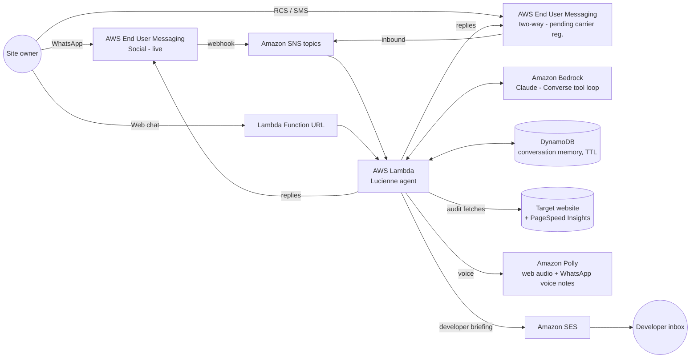

# Lucienne · Conversational Website & SEO Copilot

*From lux/luz: the one who brings light.* Text Lucienne a website address and she
inspects it like a meticulous senior engineer: speed, search visibility, metadata,
indexing. Then she explains what she found in plain words, over the channel you're
already on. Ask for depth and she emails the full developer briefing.

Built for the **AWS CDS Agentic AI Partner Hackathon** (campaign: *AWS CDS Agentic AI
Hackathon -Sept. 2026*) by Divina Endeavors LLC for customer **Hero Apps**.

## What she does

- **Converses, not dashboards.** Site owners message a URL to Lucienne on
  **WhatsApp** (AWS End User Messaging Social, live) or use the web demo; SMS/RCS
  runs through the same handler (wired, pending toll-free carrier registration).
  No login, no SaaS onboarding.
- **Talks back.** Web chat has opt-in voice and mic input; on WhatsApp she follows
  each reply with an **Amazon Polly** voice note: English delivery, and her French
  asides spoken by a French voice. Send her a voice note and **Amazon Transcribe** writes it out first.
- **Inspects for real.** An agentic core on **Amazon Bedrock** (Claude, Converse API
  tool-use) decides which inspections the conversation needs and runs them:
  - `inspect_page`: status, redirect chain, TTFB, page weight, title/meta/canonical,
    robots directives, h1 structure, image alts, Open Graph, JSON-LD, language, noindex.
  - `check_robots_sitemap`: robots.txt sanity, declared sitemaps, sitemap health.
  - `core_web_vitals`: Google PageSpeed Insights: lab LCP/CLS/TBT + real-user (CrUX) p75.
- **Explains like a human.** Plain-English findings ranked by impact, sized for a
  messaging bubble.
- **Delivers the deep report.** On request, a full HTML developer briefing lands in the
  inbox via **Amazon SES**.

## Architecture



**AWS CDS services at runtime:**

| Service | Where in code |
|---|---|
| AWS End User Messaging Social (WhatsApp, live) | `src/handler.py`: parses EUM Social webhook events, replies via `SendWhatsAppMessage`, voice notes via `PostWhatsAppMessageMedia` |
| AWS End User Messaging (RCS/SMS, two-way) | `src/handler.py`: inbound via SNS, replies via `pinpoint-sms-voice-v2 SendTextMessage` (toll-free number pending carrier registration) |
| Amazon SES | `src/agent.py`: `email_report` tool, `sesv2 SendEmail` |
| Amazon Polly | `src/handler.py`: web chat audio + WhatsApp voice notes (bilingual voice stitching) |
| Amazon Transcribe | `src/handler.py`: understands inbound WhatsApp voice notes (fetched with `GetWhatsAppMessageMedia`, language detected automatically); enable on an existing stack with `scripts/enable-voice.sh` |
| Amazon Bedrock (recommended pairing) | `src/agent.py`: Converse API tool-use loop |

## Repository layout

```
src/
  agent.py       # Bedrock Converse tool loop, persona, SES report tool
  seo_tools.py   # page inspector, robots/sitemap, Core Web Vitals (pure stdlib)
  handler.py     # Lambda entry: SNS (EUM two-way) + Function URL (web demo + chat API)
  web/index.html # the web chat demo, served by the same Lambda
infra/template.yaml  # CloudFormation: Lambda, Function URL, SNS, DynamoDB, IAM
scripts/deploy.sh    # deploy stack + upload code (aws cli only, no SAM/CDK)
scripts/chat.py      # local CLI chat for development
```

No third-party Python dependencies: stdlib + boto3 only. The Lambda zip is `src/` as-is.

## Deploy it yourself

Prereqs: an AWS account with **Bedrock model access enabled** for Claude Sonnet 4.5
(Bedrock console → Model access), a **verified SES identity**, AWS CLI v2 configured,
region `us-east-1` (or set `AWS_REGION`).

```bash
export REPORT_FROM="you@example.com"          # your verified SES identity
export ALLOWED_REPORT_RECIPIENTS="you@example.com"  # sandbox allowlist
export PSI_API_KEY="..."                      # free key: PageSpeed Insights API
scripts/deploy.sh
```

The stack outputs **WebDemoUrl**: open it and chat. That's the fastest way to judge
the project end to end.

To wire WhatsApp: link a WhatsApp Business Account in the End User Messaging Social
console, point its event destination at the stack's WhatsApp events topic, and set
`WHATSAPP_PHONE_NUMBER_ID` on the Lambda. For SMS/RCS: enable two-way messaging on
your phone number or RCS test agent and point it at the stack's **InboundTopicArn**
SNS topic (replies are sent from the same identity, or set the `OriginationIdentity`
stack parameter).

Try: `audit hero-apps.com`, then `why does the speed score matter?`, then
`email me the full report`.

## Local development

```bash
python3 scripts/chat.py "give hero-apps.com a quick check"
```

## Cost & cleanup

Pay-per-request everywhere (Lambda, DynamoDB, Bedrock tokens, SES sandbox is free).
Remove everything with `aws cloudformation delete-stack --stack-name lucienne`.

## License

MIT; see [LICENSE](LICENSE).
